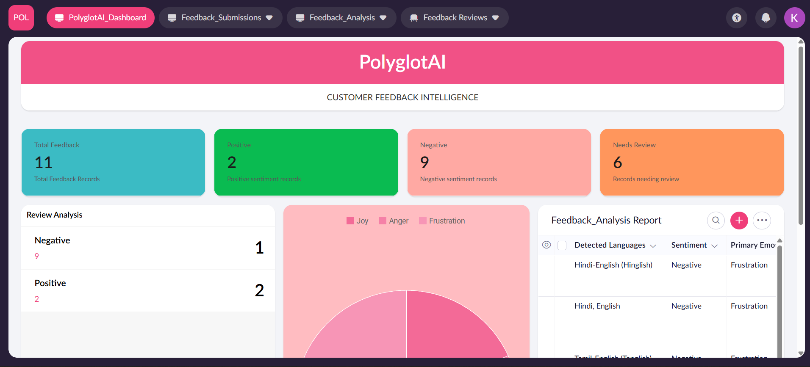

# PolyglotAI – AI-Powered Multilingual Feedback Intelligence

## Overview
PolyglotAI is an AI-powered feedback intelligence platform built using Zoho Creator and Google Gemini API.

It analyzes multilingual and code-mixed customer feedback to identify sentiment, emotions, sarcasm, topics and urgency.

## Key Features
- Multilingual feedback collection
- Automatic language detection
- Sentiment classification
- Emotion detection
- Sarcasm identification
- AI-generated feedback summaries
- Confidence-based human review
- Automated email alerts
- Feedback analysis and monitoring

## Technology Stack
- **Low-code platform:** Zoho Creator
- **AI Integration:** Google Gemini API
- **Scripting:** Deluge
- **Data Management:** Zoho Creator Forms and Reports

## Workflow
1. Customer submits feedback.
2. Feedback is stored in Zoho Creator.
3. Gemini API analyzes the feedback.
4. Analysis results are stored.
5. Low-confidence or uncertain results enter the review queue.
6. High-priority feedback triggers email alerts.

## Project Architecture
See the `documentation/` directory.

## Screenshots
See the `screenshots/` directory.

## Disclaimer
This repository contains the application structure and implementation documentation. Application records and API credentials are not included.